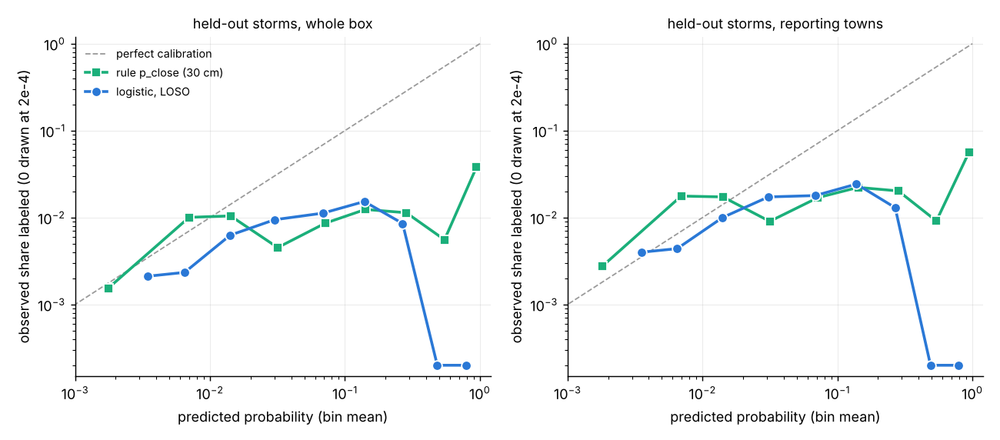
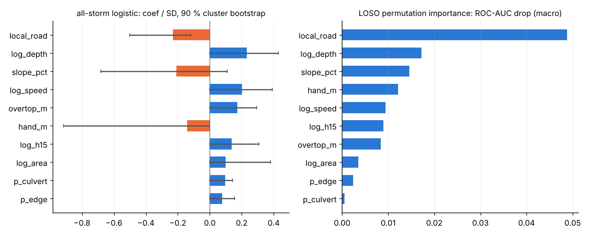

# Learned road-closure model: leave-one-storm-out (LOSO)

Made by `python proto/closure_loso.py` (reuses `proto/closure_ml.py`: same 10 hazard/terrain features `MAIN`, same sign-constrained L2 logistic with C = 0.5, same strict 30 m label matching from `extract`). Data: `docs/proto/turing/<storm>_<area>_20m/features_<storm>.csv`, 9 storms. For each held-out storm the model is fitted on the other 8 and scored on the held-out box against the rule-based closure probability `p_close` = Phi((peak depth - 0.30) / 0.10) and the may-close overtop layer `p_may_close`, both read off the same flood run. Nothing was tuned on LOSO: features, C, HGB settings and the main variant were fixed before the first LOSO run.

## Data

| storm | segments | labeled segs | sites | training domain (reporting towns) | domain segs / labeled | rule flags (p >= 0.5) |
|---|---|---|---|---|---|---|
| aug2021 | 8353 | 13 | 12 | Auburn, Worcester | 4624 / 13 | 2.2 % |
| aug2023 | 6587 | 7 | 4 | Framingham, Holliston, Hopkinton, Marlborough | 3313 / 7 | 3.6 % |
| aug2023b | 7806 | 5 | 2 | Grafton, Millbury | 1134 / 5 | 0.5 % |
| aug2026 | 4462 | 7 | 4 | Fitchburg, Leominster, Lunenburg, Princeton | 3375 / 7 | 2.2 % |
| jul2021 | 6083 | 9 | 5 | Millbury, Worcester | 3242 / 9 | 1.2 % |
| jul2023 | 6605 | 8 | 5 | Holden, Spencer, Worcester | 4760 / 8 | 0.7 % |
| sep2021 | 7586 | 11 | 5 | West Boylston, Worcester | 4540 / 11 | 4.1 % |
| sep2022 | 2408 | 6 | 4 | Oxford, Southbridge, Webster | 1434 / 6 | 1.9 % |
| sep2023 | 4462 | 97 | 127 | Leominster | 1512 / 89 | 2.8 % |

163 labeled segments in all; 97 of them are Sept 2023 (89 from the Leominster DPW inventory). The other eight storms have 5-13 each, from news / NWS / agency reports. Several boxes overlap (five Worcester-area storms, two Leominster storms), and a handful of labeled segments repeat between storms, so a leave-one-AREA-out run is reported as a check on location leakage.

## Reporting-footprint confound: treatment

- **Training** uses each storm's reporting domain only: the towns with at least one matched report in that storm; Sept 2023 keeps the old rule, Leominster city only, where the DPW inventory makes "unlabeled" close to "undamaged". Outside the reporting towns "unlabeled" mostly means "nobody reported", and a whole-box fit would learn the footprint (in Sept 2023 rain alone had AUC 0.87 for that reason, see RESULTS.md).
- **Storm-balanced weights** (each storm's domain sums to the same weight). Unweighted, Leominster's 89 DPW positives would make this a one-city model again.
- **Evaluation** on the whole held-out box (as the old blind test) and, stricter, inside the held-out storm's reporting towns, where "which town reported" cannot help any model. The held-out domain is defined from held-out labels, but identically for the rule and the model: it is only a stratum for scoring.
- The confound check row (`lr_box`, trained on whole boxes) shows what happens without the domain restriction.

## Headline (main model: logistic, storm-balanced, reporting domains)

Pooled over the 9 held-out storms (54352 segments, 163 labeled). [a, b] = 5-95 % two-stage cluster bootstrap (storms, then 2 km blocks); "P(>0)" = share of bootstrap replicates where learned minus rule is positive.

| metric | learned (LOSO) | rule p_close | may-close layer | learned - rule, 90 % CI | P(>0) |
|---|---|---|---|---|---|
| ROC-AUC, stratified (pairs within the same storm) | 0.783 [0.73, 0.83] | 0.757 [0.66, 0.80] | 0.747 | +0.027 [-0.009, 0.098] | 0.89 |
| ROC-AUC (all storms concatenated; see note) | 0.605 [0.55, 0.81] | 0.783 [0.65, 0.83] | 0.775 | -0.178 [-0.254, 0.102] | 0.37 |
| ROC-AUC (mean of per-storm differences) | 0.765 | 0.700 | 0.696 | +0.065 [0.011, 0.118] | 0.97 |
| PR-AUC (pooled) | 0.007 [0.00, 0.01] | 0.018 [0.00, 0.05] | 0.016 | -0.011 [-0.033, 0.002] | 0.20 |
| recall at the rule's flagged share (2.1 % of segments) | 0.12 [0.06, 0.21] | 0.22 [0.09, 0.30] | - | -0.10 [-0.15, 0.00] | 0.03 |
| flagged share needed for the rule's recall | 2.3 % | 2.1 % | - | - | - |
| lift at the rule's flagged share (recall / share) | 5.8 | 10.4 | - | - | - |
| recall at the may-close layer's share (4.4 %) | 0.28 | - | 0.33 | - | - |
| flagged share for the may-close layer's recall | 3.2 % | - | 4.4 % | - | - |
| Brier (BSS vs base rate) | 0.0035 (-0.17) | 0.0199 (-5.64) | - | - | - |
| expected / labeled | 479 / 163 | 1453 / 163 | - | - | - |

Storm-by-storm the learned model has the higher ROC-AUC on **7 of 9** storms (one-sided sign test p = 0.09), higher PR-AUC on 5 of 9, and higher recall at the rule's flagged share on 1 of 9 (tied on 4). Inside the held-out reporting towns it wins ROC-AUC on 9 of 9.

Same, scored only inside each held-out storm's reporting towns:

| metric | learned | rule | learned - rule, 90 % CI |
|---|---|---|---|
| ROC-AUC stratified | 0.788 | 0.744 | +0.043 [0.013, 0.101] |
| ROC-AUC concatenated | 0.597 | 0.779 | -0.182 [-0.269, 0.118] |
| PR-AUC pooled | 0.011 | 0.029 | -0.017 [-0.058, 0.004] |
| recall at rule's share (2.7 %) | 0.19 | 0.23 | -0.05 [-0.09, 0.02] |
| share for rule's recall | 2.7 % | 2.7 % | - |

## Model variants (pooled over held-out storms, whole box)

| model | stratified ROC-AUC | mean per-storm ROC-AUC | PR-AUC (concat.) | recall at rule share | share for rule recall | recall at may-close share | wins ROC / PR (of 9) | stratified ROC-AUC in reporting towns |
|---|---|---|---|---|---|---|---|---|
| logistic, storm-balanced, reporting domains (main) | 0.783 | 0.765 | 0.007 | 0.12 | 2.3 % | 0.28 | 7 / 5 | 0.788 |
| logistic, unweighted, reporting domains | 0.782 | 0.761 | 0.009 | 0.15 | 2.3 % | 0.31 | 7 / 4 | 0.789 |
| logistic, storm-balanced, whole boxes (confound check) | 0.771 | 0.757 | 0.009 | 0.17 | 1.9 % | 0.33 | 7 / 4 | 0.766 |
| HistGB monotone + Platt, storm-balanced, reporting domains | 0.753 | 0.716 | 0.009 | 0.14 | 3.2 % | 0.30 | 5 / 3 | 0.746 |
| logistic main, leave-one-AREA-out (overlapping boxes held out together) | 0.782 | 0.761 | 0.007 | 0.14 | 2.0 % | 0.28 | 7 / 6 | 0.784 |
| POST HOC: logistic main + logit(p_close) feature | 0.783 | 0.765 | 0.007 | 0.12 | 2.3 % | 0.28 | 7 / 5 | 0.788 |
| POST HOC: rule-first hybrid (p_close >= 0.5 first, then learned order) | 0.788 | 0.767 | 0.011 | 0.22 | 1.4 % | 0.34 | 8 / 7 | 0.790 |
| *rule p_close (reference)* | 0.757 | 0.700 | 0.018 | 0.22 | 2.1 % | - | - | 0.744 |
| *may-close layer (reference)* | 0.747 | 0.696 | 0.016 | - | - | 0.33 | - | 0.731 |

`lr_prior`: the rule's logit got a negative weight next to log_depth and the sign check dropped it (prior_logit), so this variant reduces to the main model. The hybrid has no probabilities of its own (Brier not defined); bootstrap for it:
stratified ROC-AUC 0.788 [0.73, 0.83] vs rule 0.757 (diff +0.031 [-0.003, 0.098], P(>0) 0.94); PR-AUC 0.011 vs 0.018 (diff [-0.023, 0.003], P(>0) 0.29).

## Per storm (main model, whole held-out box)

rec@rule = recall when the learned model flags as many segments as the rule does (p_close >= 0.5); share@rule-rec = flagged share the learned model needs to match the rule's recall; site = share of documented sites with a flagged segment. Intervals: 5-95 % paired 2 km block bootstrap within the storm.

| held-out | labeled | ROC-AUC learned | ROC-AUC rule | ROC may-close | PR-AUC learned | PR-AUC rule | rule share | rule recall | learned rec@rule | site: rule / learned | share@rule-rec | lift rule / learned | dROC 90 % CI |
|---|---|---|---|---|---|---|---|---|---|---|---|---|---|
| aug2021 | 13 | 0.848 | 0.798 | 0.770 | 0.021 [0.00, 0.08] | 0.029 [0.00, 0.10] | 2.2 % | 0.38 | 0.23 | 0.42 / 0.33 | 2.4 % | 17.2 / 10.3 | [-0.038, 0.189] |
| aug2023 | 7 | 0.800 | 0.685 | 0.700 | 0.004 [0.00, 0.01] | 0.005 [0.00, 0.02] | 3.6 % | 0.29 | 0.00 | 0.25 / 0.00 | 4.9 % | 8.0 / 0.0 | [-0.104, 0.321] |
| aug2023b | 5 | 0.746 | 0.581 | 0.633 | 0.007 [0.00, 0.03] | 0.001 [0.00, 0.00] | 0.5 % | 0.00 | 0.00 | 0.00 / 0.00 | 0.0 % | 0.0 / 0.0 | [-0.030, 0.349] |
| aug2026 | 7 | 0.753 | 0.718 | 0.628 | 0.006 [0.00, 0.02] | 0.005 [0.00, 0.01] | 2.2 % | 0.14 | 0.14 | 0.25 / 0.25 | 1.3 % | 6.5 / 6.5 | [-0.127, 0.280] |
| jul2021 | 9 | 0.698 | 0.641 | 0.604 | 0.015 [0.01, 0.03] | 0.007 [0.00, 0.03] | 1.2 % | 0.11 | 0.22 | 0.20 / 0.40 | 1.1 % | 9.1 / 18.3 | [-0.083, 0.243] |
| jul2023 | 8 | 0.747 | 0.710 | 0.705 | 0.003 [0.00, 0.01] | 0.003 [0.00, 0.01] | 0.7 % | 0.00 | 0.00 | 0.00 / 0.00 | 0.0 % | 0.0 / 0.0 | [-0.007, 0.117] |
| sep2021 | 11 | 0.794 | 0.798 | 0.797 | 0.010 [0.00, 0.04] | 0.026 [0.00, 0.12] | 4.1 % | 0.36 | 0.27 | 0.40 / 0.40 | 4.9 % | 8.9 / 6.7 | [-0.015, 0.006] |
| sep2022 | 6 | 0.715 | 0.582 | 0.643 | 0.008 [0.00, 0.02] | 0.004 [0.00, 0.01] | 1.9 % | 0.00 | 0.00 | 0.00 / 0.00 | 0.0 % | 0.0 / 0.0 | [0.051, 0.199] |
| sep2023 | 97 | 0.787 | 0.792 | 0.784 | 0.080 [0.04, 0.13] | 0.118 [0.06, 0.18] | 2.8 % | 0.24 | 0.11 | 0.37 / 0.17 | 5.4 % | 8.5 / 4.0 | [-0.058, 0.051] |

HistGB (monotone) per storm, ROC-AUC / PR-AUC: aug2021 0.820 / 0.014; aug2023 0.738 / 0.003; aug2023b 0.694 / 0.006; aug2026 0.813 / 0.005; jul2021 0.650 / 0.031; jul2023 0.631 / 0.002; sep2021 0.747 / 0.005; sep2022 0.578 / 0.007; sep2023 0.774 / 0.083.
Leave-one-area-out logistic, ROC-AUC: aug2021 0.847; aug2023 0.800; aug2023b 0.762; aug2026 0.675; jul2021 0.694; jul2023 0.766; sep2021 0.805; sep2022 0.715; sep2023 0.784.

Per storm inside reporting towns (main), ROC-AUC learned / rule: aug2021 0.848 / 0.789; aug2023 0.792 / 0.679; aug2023b 0.728 / 0.571; aug2026 0.770 / 0.712; jul2021 0.696 / 0.595; jul2023 0.738 / 0.695; sep2021 0.780 / 0.769; sep2022 0.716 / 0.563; sep2023 0.808 / 0.801.

## Calibration

LOSO probabilities of the main model. Whole boxes: Brier 0.0035 (BSS -0.17) vs rule 0.0199 (BSS -5.64); expected 479 vs 163 labeled (rule: 1453). Inside the reporting domains: Brier 0.0061 (BSS -0.11) vs rule 0.0262 (BSS -3.74); expected 270 vs 155 labeled (rule 910).

Per bin (mean P -> observed share labeled (segments, labeled)):

- ml_box: 0.003 -> 0.002 (31249, 66); 0.006 -> 0.002 (15808, 37); 0.014 -> 0.006 (3668, 23); 0.030 -> 0.009 (2436, 23); 0.069 -> 0.011 (712, 8); 0.139 -> 0.015 (327, 5); 0.268 -> 0.009 (117, 1); 0.483 -> 0.000 (30, 0); 0.790 -> 0.000 (5, 0)
- rule_box: 0.002 -> 0.002 (47322, 73); 0.007 -> 0.010 (1890, 19); 0.014 -> 0.010 (1245, 13); 0.032 -> 0.005 (1107, 5); 0.072 -> 0.009 (580, 5); 0.142 -> 0.012 (484, 6); 0.285 -> 0.011 (440, 5); 0.547 -> 0.006 (360, 2); 0.943 -> 0.038 (924, 35)
- ml_domain: 0.004 -> 0.004 (15522, 62); 0.006 -> 0.004 (8428, 37); 0.014 -> 0.010 (1898, 19); 0.031 -> 0.017 (1332, 23); 0.068 -> 0.018 (447, 8); 0.138 -> 0.024 (206, 5); 0.268 -> 0.013 (77, 1); 0.490 -> 0.000 (20, 0); 0.784 -> 0.000 (4, 0)
- rule_domain: 0.002 -> 0.003 (23962, 66); 0.007 -> 0.018 (1075, 19); 0.014 -> 0.017 (695, 12); 0.031 -> 0.009 (553, 5); 0.072 -> 0.017 (295, 5); 0.142 -> 0.022 (270, 6); 0.282 -> 0.020 (247, 5); 0.541 -> 0.009 (219, 2); 0.945 -> 0.057 (618, 35)

Per storm expected / labeled (learned, rule): aug2021 79 / 241 vs 13; aug2023 76 / 269 vs 7; aug2023b 48 / 73 vs 5; aug2026 52 / 122 vs 7; jul2021 46 / 106 vs 9; jul2023 37 / 62 vs 8; sep2021 102 / 354 vs 11; sep2022 23 / 65 vs 6; sep2023 16 / 161 vs 97.

PU constant (Elkan-Noto e1) from LOSO predictions on labeled segments inside reporting domains: c = **0.019** (stored in the model file).

## Drivers

Final all-storm logistic (intercept -5.22; log-odds per SD). CI = 5-95 % two-stage cluster bootstrap (storms, 2 km blocks), "kept" = share of replicates where the sign check kept the feature. Permutation = mean drop in held-out ROC-AUC (LOSO models, macro over storms, 5 shuffles).

| feature | expected sign | coef / SD | 90 % CI | kept | permutation dROC-AUC | storms where permutation hurts |
|---|---|---|---|---|---|---|
| local_road | free | -0.231 | [-0.50, -0.12] | 1.00 | +0.0488 | 7 / 9 |
| log_depth | + | +0.230 | [+0.00, +0.43] | 0.75 | +0.0172 | 6 / 9 |
| slope_pct | free | -0.208 | [-0.68, +0.11] | 1.00 | +0.0146 | 6 / 9 |
| log_speed | + | +0.203 | [+0.00, +0.39] | 0.82 | +0.0094 | 5 / 9 |
| overtop_m | + | +0.172 | [+0.00, +0.29] | 0.86 | +0.0084 | 7 / 9 |
| hand_m | - | -0.142 | [-0.91, +0.00] | 0.87 | +0.0121 | 8 / 9 |
| log_h15 | + | +0.136 | [+0.00, +0.31] | 0.87 | +0.0090 | 6 / 9 |
| log_area | + | +0.099 | [+0.00, +0.38] | 0.72 | +0.0035 | 5 / 9 |
| p_culvert | + | +0.097 | [+0.00, +0.14] | 0.63 | +0.0005 | 1 / 9 |
| p_edge | + | +0.077 | [+0.00, +0.16] | 0.83 | +0.0024 | 6 / 9 |

Dropped from the final fit for contradicting the expected sign: none.

## Note on pooled metrics

"Concatenated" ROC-AUC / PR-AUC rank all 54 352 segments of all storms on one scale. The rule's p_close is an absolute depth threshold, so its level carries
across storms. The learned model's level does not (it predicts 16 closures for Sept 2023 Leominster against 97 labeled, and 76 for Aug 2023 against 7),
because each storm's reporting completeness is different and the model is trained to the average. Concatenated scores therefore mostly measure
between-storm calibration. For "which roads in this storm", the relevant number is the **stratified** ROC-AUC (only positive/negative pairs from the same
storm), the per-storm table, and recall at the rule's flagged share (each storm flagged at its own rule share).

## Conclusions

1. **Overall ranking: the learned model beats the rule out of storm, modestly.** Stratified ROC-AUC is 0.783 against 0.757. The per-storm mean is
   0.765 against 0.700, with the mean per-storm difference +0.065 [0.011, 0.118]. The learned model wins on 7 of 9 storms on the whole box and on 9 of 9 inside the
   reporting towns. The gains are largest where the rule is weakest (rule ROC-AUC 0.58-0.69): Aug 2023 MetroWest, Aug 2023b Millbury and Sept 2022 Webster.
   In Millbury and Webster the rule flags none of the reported segments, and the learned model still puts them on average in the top 20-30 %
   (ROC-AUC 0.75 and 0.72; Webster is the only storm whose per-storm interval excludes zero). The result holds when overlapping boxes are held
   out together (leave-one-area-out 0.782), so it does not come from remembering repeat sites.
2. **Top of the list: the learned model loses to the rule, and this is the operational number.** Suppose the learned model flags as many segments as the rule
   does (2.1 % of the box). It then finds 12 % of the labeled segments, while the rule finds 22 % (difference -0.10 [-0.15, 0.00]). Its lift is 5.8 against 10.4. PR-AUC is lower too,
   0.007 against 0.018. The learned model wins on recall at the rule's share in only 1 storm (Jul 2021) and loses clearly in Aug 2021, Aug 2023 and Sept 2023.
   With few positives the model learns gentle slopes: depth is about as heavy as road class and slope, so deep water on the road no longer dominates. The rule's hard
   30 cm threshold is the sharper top-k signal. Adding the rule's own logit as a feature did not help, because its fitted weight came out negative next to log_depth and the sign check
   dropped it.
3. **Best of both (post hoc, so treat it as a hypothesis for the next storm).** Rank the rule's flagged set first and order everything, including the inside of that set, by the
   learned P. This keeps the rule's top recall (0.22). It reaches that recall with **1.4 %** of segments instead of 2.1 %, by breaking the rule's ties. Its
   stratified ROC-AUC is 0.788, and it has the best recall at the may-close share (0.34 against 0.33). It wins ROC-AUC on 8 of 9 storms.
4. **The may-close overtop layer** ranks about like the rule (stratified 0.747) and adds nothing at the top that the learned model does not have.
5. **Model class.** The monotone HistGB is worse than the logistic model (stratified 0.753, per-storm 0.716, 5 of 9 wins), as it was with LightGBM on one storm. Weighting
   barely matters for ranking: unweighted 0.782 against balanced 0.783. Unweighted gets slightly better top recall (0.15) because Leominster's denser labels sharpen it.
6. **Reporting footprint.** Training on whole boxes instead of reporting towns costs a little ranking quality inside reporting towns (0.766 against 0.788). It gains top recall
   on the whole box (0.17 against 0.12) by learning where reports come from. That gain is the confound, so the domain restriction stays. The largest coefficient is
   **local_road (-0.23 / SD, CI excludes 0)**: reports favour named arterials. That is partly real (more traffic, more exposure, culverts sized for streets) and partly reporting
   bias (news names main roads). It cannot be separated with these labels, and it is the main reason not to read the learned P as a physical closure probability.
7. **Drivers (all-storm fit).** After road class, the drivers are depth, slope (negative), flow speed, overtopping beside the road, HAND (negative) and hours over 15 cm.
   Every hazard coefficient has the expected sign, and none is dropped in the final fit. Their 90 % intervals touch 0, because the sign check zeroes a feature in 13-37 % of
   cluster-bootstrap replicates. Culvert overtopping carries almost no out-of-storm weight (permutation importance about 0, kept in 63 % of replicates).
8. **Calibration.** The learned P is far better calibrated than p_close (Brier 0.0035 against 0.0199; expected 479 against 1453 for 163 labeled), but it still runs high
   outside the reporting towns and has negative skill against the base rate (BSS -0.17). It is P(documented), and documentation completeness changes from storm to storm. The Elkan-Noto
   c (0.019) is not usable as a PU correction here: e1 needs a classifier that is near-certain somewhere, and this one is not. The probabilities should be shown as a relative
   ranking, not as a percentage chance of closure.
9. **Uncertainty.** Eight of the nine storms have 5-13 labeled segments from 2-12 sites. Every per-storm interval for the difference in ROC-AUC except
   Sept 2022's includes zero. The pooled sign test (7 of 9) gives p = 0.09. The pooled per-storm mean difference is the only ranking gain whose 90 % interval excludes zero.

## Recommendation

- The all-storm logistic (`docs/proto/ml/closure_lr_all.json`) replaces the Sept 2023-only fit as the learned layer. `closure_ml.py map` now uses it by default
  (`--model` or `$PROTO_ML_MODEL` overrides). Keep `p_close` as the alert layer. Use the learned P to order segments within and beyond the rule's flags (the hybrid),
  and test that ordering on the next storm before claiming it.
- The highest-value next data is a second complete inventory, a DPW list like Leominster's for one Worcester storm. With news-only labels, top-of-list
  comparisons will stay inside the noise.
