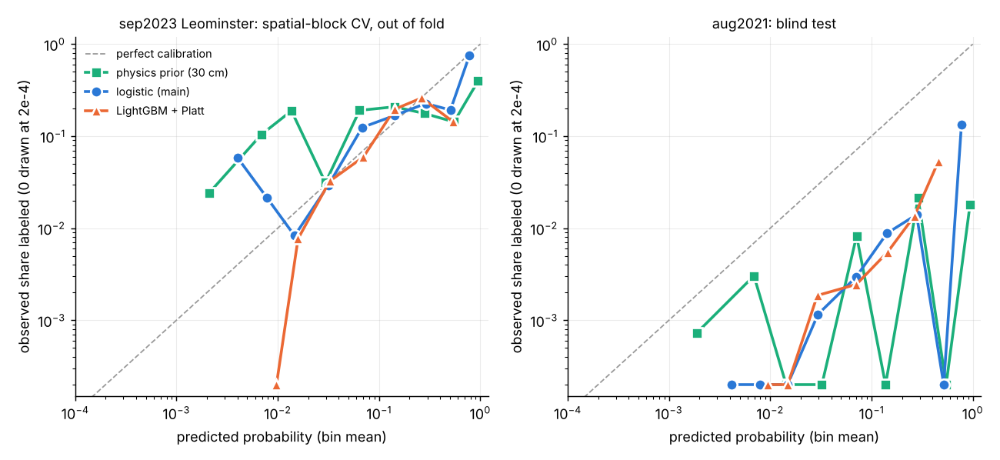
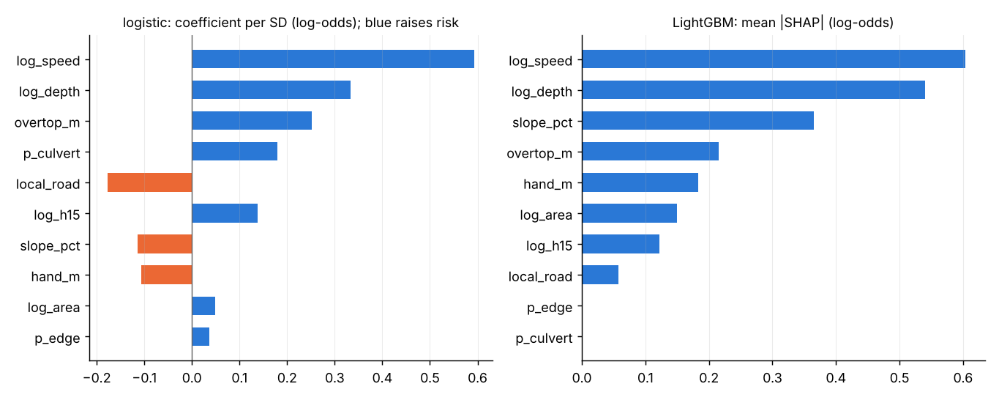

# Learned road-closure model (closure_ml): results

Made by `python proto/closure_ml.py evaluate` (selftest: `python proto/closure_ml.py selftest`). Train storm `sep2023` (run `docs/proto/exp/edge_base/rundir`), training domain: Leominster. Blind test: `aug2021` (run `docs/proto/exp/wo_rundir/rundir`). Nothing was fitted, calibrated or selected on a test storm (see "How the design was chosen").

## Scores

PR-AUC = average precision with labeled segments as positives (chance = base rate). rec@k = share of labeled segments in the top k % of segments; site@k = share of documented sites with at least one matched segment in the top k %. Brier / BSS (skill vs always predicting the base rate) use each model's own probabilities; "expected" = sum of P against the labeled count. Ties (the prior is ~0 on most dry segments) are broken at random. [a, b] = 5-95 % bootstrap interval over segments.

### sep2023 Leominster: spatial block CV (2 km blocks, 5 folds), out of fold. 1533 segments, 89 labeled (5.81 %)

| model | PR-AUC | ROC-AUC | rec@2% | rec@5% | rec@10% | site@2% | site@5% | site@10% | Brier | BSS | expected / labeled |
|---|---|---|---|---|---|---|---|---|---|---|---|
| physics prior p_close (30 cm, sigma 10 cm) | 0.245 [0.19, 0.33] | 0.797 | 0.16 | 0.27 [0.21, 0.35] | 0.40 | 0.25 | 0.40 | 0.53 | 0.0626 | -0.145 | 73 / 89 |
| prior, Platt-calibrated on train | 0.245 | 0.797 | 0.16 | 0.27 | 0.40 | 0.25 | 0.40 | 0.53 | 0.0513 | 0.062 | 89 / 89 |
| **logistic, hazard features (main)** | 0.264 [0.20, 0.35] | 0.793 | 0.11 | 0.26 [0.18, 0.32] | 0.40 | 0.23 | 0.42 | 0.58 | 0.0500 | 0.085 | 89 / 89 |
| logistic + worst-hour rain | 0.261 | 0.773 | 0.13 | 0.25 | 0.46 | 0.23 | 0.39 | 0.60 | 0.0501 | 0.083 | 90 / 89 |
| LightGBM monotone + Platt | 0.182 [0.14, 0.24] | 0.787 | 0.08 | 0.19 [0.15, 0.27] | 0.38 | 0.19 | 0.34 | 0.56 | 0.0515 | 0.058 | 91 / 89 |

### sep2023 whole box: in-domain out of fold + out-of-domain from the final fit. 5096 segments, 97 labeled (1.90 %)

| model | PR-AUC | ROC-AUC | rec@2% | rec@5% | rec@10% | site@2% | site@5% | site@10% | Brier | BSS | expected / labeled |
|---|---|---|---|---|---|---|---|---|---|---|---|
| physics prior p_close (30 cm, sigma 10 cm) | 0.126 [0.09, 0.18] | 0.819 | 0.24 | 0.34 [0.27, 0.43] | 0.52 | 0.37 | 0.47 | 0.65 | 0.0288 | -0.545 | 144 / 97 |
| prior OR overtopping (p_may_close) | 0.113 | 0.815 | 0.22 | 0.35 | 0.48 | 0.36 | 0.46 | 0.59 | 0.0516 | -1.765 | 294 / 97 |
| **logistic, hazard features (main)** | 0.131 [0.09, 0.19] | 0.801 | 0.16 | 0.35 [0.27, 0.43] | 0.54 | 0.31 | 0.54 | 0.68 | 0.0207 | -0.106 | 234 / 97 |
| LightGBM monotone + Platt | 0.078 | 0.802 | 0.10 | 0.28 | 0.49 | 0.20 | 0.43 | 0.66 | 0.0201 | -0.079 | 246 / 97 |
| v0: logistic + rain, whole box (first run) | 0.238 | 0.894 | 0.32 | 0.55 | 0.66 | 0.45 | 0.65 | 0.70 | 0.0163 | 0.125 | 94 / 97 |
| 12-member ensemble mean P (older defaults) | 0.152 | 0.903 | 0.23 | 0.33 | 0.52 | 0.35 | 0.45 | 0.64 | 0.0280 | -0.500 | 143 / 97 |

### aug2021: blind test, final models as saved. 8373 segments, 15 labeled (0.18 %)

| model | PR-AUC | ROC-AUC | rec@2% | rec@5% | rec@10% | site@2% | site@5% | site@10% | Brier | BSS | expected / labeled |
|---|---|---|---|---|---|---|---|---|---|---|---|
| physics prior p_close (30 cm, sigma 10 cm) | 0.023 [0.01, 0.07] | 0.780 | 0.27 | 0.40 [0.14, 0.60] | 0.60 | 0.33 | 0.50 | 0.67 | 0.0353 | -18.718 | 405 / 15 |
| prior, Platt-calibrated on train | 0.023 | 0.780 | 0.27 | 0.40 | 0.60 | 0.33 | 0.50 | 0.67 | 0.0094 | -4.249 | 467 / 15 |
| prior OR overtopping (p_may_close) | 0.012 | 0.797 | 0.25 | 0.33 | 0.60 | 0.32 | 0.42 | 0.67 | 0.0655 | -35.649 | 704 / 15 |
| **logistic, hazard features (main)** | 0.040 [0.01, 0.17] | 0.888 | 0.20 | 0.40 [0.18, 0.62] | 0.67 | 0.25 | 0.50 | 0.75 | 0.0099 | -4.552 | 385 / 15 |
| logistic + worst-hour rain | 0.018 | 0.858 | 0.13 | 0.33 | 0.53 | 0.17 | 0.42 | 0.67 | 0.0034 | -0.902 | 130 / 15 |
| LightGBM monotone + Platt | 0.020 [0.01, 0.08] | 0.866 | 0.20 | 0.40 [0.18, 0.64] | 0.53 | 0.25 | 0.50 | 0.67 | 0.0066 | -2.678 | 361 / 15 |
| v0: logistic + rain, whole box (first run) | 0.011 | 0.807 | 0.13 | 0.13 | 0.47 | 0.17 | 0.17 | 0.58 | 0.0023 | -0.266 | 44 / 15 |

## Reliability

Per bin (edges 0, 0.005, 0.01, 0.02, 0.05, 0.1, 0.2, 0.4, 0.7, 1): mean P -> observed share labeled (segments, labeled).

- sep2023 Leominster, prior: 0.002 -> 0.024 (1197, 29); 0.007 -> 0.104 (106, 11); 0.014 -> 0.188 (69, 13); 0.030 -> 0.031 (32, 1); 0.064 -> 0.190 (21, 4); 0.142 -> 0.208 (24, 5); 0.281 -> 0.176 (17, 3); 0.550 -> 0.143 (14, 2); 0.950 -> 0.396 (53, 21)
- sep2023 Leominster, lr: 0.004 -> 0.059 (17, 1); 0.008 -> 0.021 (140, 3); 0.015 -> 0.008 (362, 3); 0.032 -> 0.029 (645, 19); 0.068 -> 0.124 (169, 21); 0.144 -> 0.168 (113, 19); 0.289 -> 0.226 (53, 12); 0.507 -> 0.192 (26, 5); 0.780 -> 0.750 (8, 6)
- sep2023 Leominster, gbm: 0.010 -> 0.000 (1, 0); 0.016 -> 0.008 (391, 3); 0.033 -> 0.032 (616, 20); 0.070 -> 0.059 (303, 18); 0.142 -> 0.196 (138, 27); 0.263 -> 0.260 (77, 20); 0.541 -> 0.143 (7, 1)
- aug2021, prior: 0.002 -> 0.001 (6862, 5); 0.007 -> 0.003 (329, 1); 0.014 -> 0.000 (216, 0); 0.032 -> 0.000 (203, 0); 0.071 -> 0.008 (121, 1); 0.138 -> 0.000 (125, 0); 0.288 -> 0.021 (140, 3); 0.545 -> 0.000 (102, 0); 0.940 -> 0.018 (275, 5)
- aug2021, lr: 0.004 -> 0.000 (210, 0); 0.008 -> 0.000 (1015, 0); 0.015 -> 0.000 (3036, 0); 0.030 -> 0.001 (2581, 3); 0.070 -> 0.003 (678, 2); 0.142 -> 0.009 (454, 4); 0.278 -> 0.014 (285, 4); 0.516 -> 0.000 (99, 0); 0.772 -> 0.133 (15, 2)
- aug2021, gbm: 0.009 -> 0.000 (68, 0); 0.015 -> 0.000 (3944, 0); 0.029 -> 0.002 (2689, 5); 0.071 -> 0.002 (815, 2); 0.144 -> 0.006 (544, 3); 0.266 -> 0.014 (294, 4); 0.455 -> 0.053 (19, 1)

## Drivers

Main logistic model (intercept -3.36 on standardised features; coefficients are log-odds per standard deviation) and LightGBM mean |SHAP|, both on the training domain.

| feature | expected sign | logistic coef / SD | LightGBM mean abs SHAP | with rain: logistic coef |
|---|---|---|---|---|
| log_speed | + | +0.593 | 0.604 | 0.574 |
| peak1h_mm | + | not used | - | 0.434 |
| log_depth | + | +0.333 | 0.540 | 0.317 |
| overtop_m | + | +0.251 | 0.216 | 0.212 |
| p_culvert | + | +0.179 | 0.000 | 0.188 |
| local_road | free | -0.177 | 0.057 | -0.187 |
| log_h15 | + | +0.139 | 0.122 | 0.136 |
| slope_pct | free | -0.114 | 0.366 | -0.066 |
| hand_m | - | -0.106 | 0.183 | -0.137 |
| log_area | + | +0.049 | 0.150 | 0.078 |
| p_edge | + | +0.036 | 0.000 | 0.017 |

Dropped from the main logistic model because the fitted sign contradicted physics: none.

## Positive-unlabeled correction

Unreported is not dry. Elkan & Noto (2008) e1: c = mean out-of-fold P over labeled segments in the training domain = **0.184**. If the labels were a random sample of the damaged segments, P(damaged) ~ P(documented) / c, about 5.4x the documented count. e1 assumes the classifier is near-certain somewhere, which a weak rare-event model is not, so read it as an upper-bound style factor. Ranking metrics are unchanged by it (monotone rescaling); the saved model outputs P(documented) at Leominster-city reporting completeness and stores c alongside.

## How the design was chosen (and what was seen when)

1. **First run (v0).** All 11 features, including worst-hour rain, trained on the whole Leominster box with 4 km spatial blocks. In spatial CV it looked strong: PR-AUC 0.24 against 0.13 for the prior. It was then scored once on Worcester and **collapsed**, to below the prior (row "v0" in the tables).
2. **Diagnosis on the training storm alone.** 89 of the 97 labeled segments lie in Leominster city. The DPW damage inventory covers only Leominster, and the city sits under the rain core (median worst hour 78 mm at labeled segments against 38 mm box-wide). Rain alone had univariate AUC 0.87, so the model was learning the reporting footprint. Inside Leominster, where reporting is near-complete, adding rain changes nothing (2 km CV PR-AUC 0.261 with rain, 0.264 without). Rain also acts on closures through the flood model's depth and speed already.
3. **Adopted design.** The main model uses hazard and terrain features only, with rain kept as a comparison row. It is trained on Leominster city only, so "unlabeled" there is close to "not damaged". CV uses 2 km blocks inside that domain. The Worcester numbers for the adopted design were computed once, after this choice. Worcester was seen in step 1, so it is not a perfectly untouched test, but no parameter was fitted or tuned on it. The C = 0.5 penalty, the LightGBM settings and the feature transforms were fixed before any Worcester run.

## Caveats

- **Small, incomplete labels.** Leominster city has 89 labeled segments. Worcester has 15 labeled segments from 12 sites, so its bootstrap intervals are wide (PR-AUC [0.01, 0.17]). None of the differences on the blind test is statistically secure.
- **Calibration does not transfer across reporting regimes.** The model outputs P(documented) at Leominster-DPW completeness. Worcester labels are news and NWS reports, about 30x sparser per segment. The logistic model therefore expects 385 closures there against 15 labeled. That gap measures under-reporting as much as model error. The raw prior over-predicts by the same order (405 against 15).
- **Run settings differ between storms.** Worcester uses `wo_rundir`, which has the older defaults: CN x 1.0 and no D4 breaching, though it does have `vel_max.npz`. No Worcester run with the current defaults and velocity (`wo_edge`) existed when this was made. `dm_wor_d4dams` has D4 but no velocity. Edge-washout speeds come from snapshot speeds in Leominster and from `vmax` in Worcester.
- **HAND is approximate.** It uses the Euclidean-nearest stream cell, with streams at 0.5 km2 or more of D8 area on the channel-burned model ground. It is not a flow-path HAND.
- **Not tested on Vermont.** No Vermont run dir existed when this was made.
- **LightGBM** is weaker than the logistic model with about 90 positives. It is kept as a check, not as a candidate.

## Recommendation

- **Use the logistic hazard model as the dissertation's learned closure layer.** Its 11 coefficients are interpretable and sign-checked. On ranking it is at least as good as the 30 cm prior where labels are complete. On the blind storm it is better on PR-AUC, ROC-AUC and recall at 10 % (equal at 5 %, lower at 2 %). Its probabilities are calibrated on the training storm (BSS +0.09 against -0.15 for the prior). The main drivers are flow speed on the road, depth, how far the water beside the road rises above the crest, culvert overtopping and duration over 15 cm.
- **Keep `p_close` (the physics prior) as the map default for now.** Show `p_close_ml` (`PROTO_ML=1`) as a candidate layer until a second fully-reported storm is available for training or testing. That would be a DPW inventory for Worcester 2021, or Vermont 2023.
- **Never feed storm-scale rain or other footprint variables directly** while the labels come from a single city's inventory.
