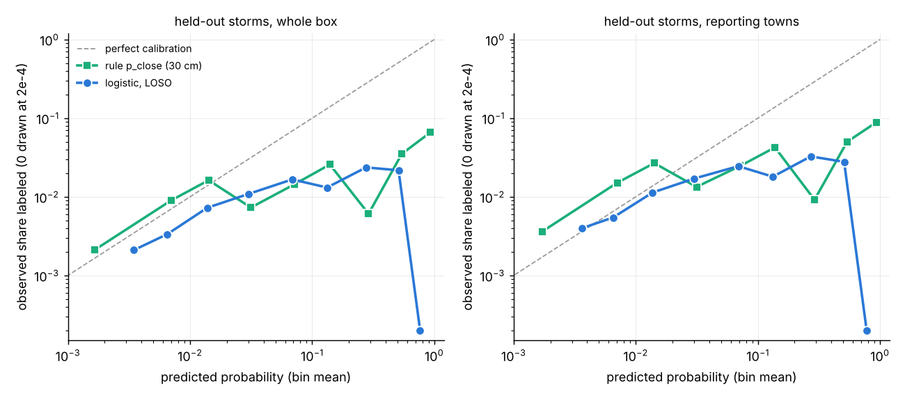
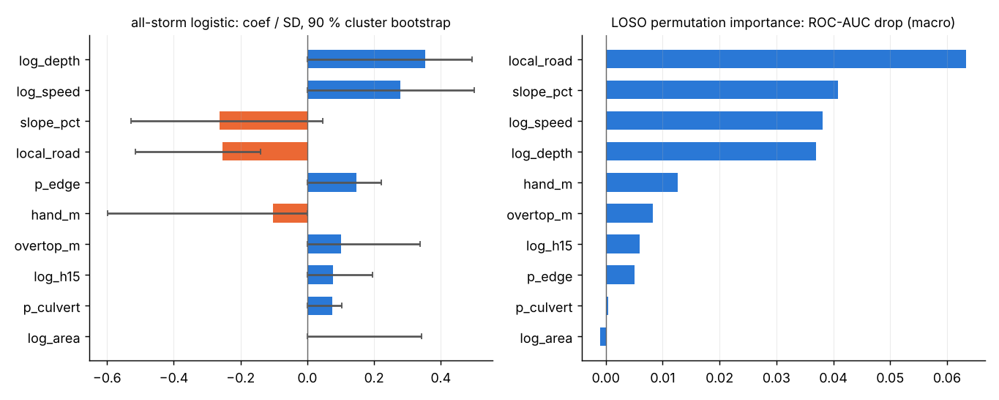

# Learned road-closure model: leave-one-storm-out (LOSO)

Made by `python proto/closure_loso.py` (reuses `proto/closure_ml.py`: same 10 hazard/terrain features `MAIN`, same sign-constrained L2 logistic with C = 0.5, same strict 30 m label matching from `extract`). Data: `docs/proto/parity/catalog/<storm>_<area>_20m/features_<storm>.csv`, 9 storms. For each held-out storm the model is fitted on the other 8 and scored on the held-out box against the rule-based closure probability `p_close` = Phi((peak depth - 0.30) / 0.10) and the may-close overtop layer `p_may_close`, both read off the same flood run. Nothing was tuned on LOSO: features, C, HGB settings and the main variant were fixed before the first LOSO run.

## Data

| storm | segments | labeled segs | sites | training domain (reporting towns) | domain segs / labeled | rule flags (p >= 0.5) |
|---|---|---|---|---|---|---|
| aug2021 | 8566 | 23 | 12 | Auburn, Worcester | 4759 / 23 | 1.1 % |
| aug2023 | 6679 | 12 | 5 | Framingham, Holliston, Hopkinton, Marlborough, Natick | 4270 / 12 | 1.6 % |
| aug2023b | 8013 | 5 | 2 | Grafton, Millbury | 1174 / 5 | 0.1 % |
| aug2026 | 4542 | 7 | 4 | Fitchburg, Leominster, Lunenburg, Princeton | 3442 / 7 | 1.4 % |
| jul2021 | 6275 | 13 | 5 | Millbury, Worcester | 3362 / 13 | 0.2 % |
| jul2023 | 6775 | 8 | 5 | Holden, Spencer, Worcester | 4887 / 8 | 0.1 % |
| sep2021 | 7775 | 12 | 6 | Millbury, West Boylston, Worcester | 5036 / 12 | 2.4 % |
| sep2022 | 2472 | 6 | 4 | Oxford, Southbridge, Webster | 1472 / 6 | 0.6 % |
| sep2023 | 4542 | 113 | 143 | Leominster | 1521 / 102 | 2.2 % |

199 labeled segments in all; 113 of them are Sept 2023 (89 from the Leominster DPW inventory). The other eight storms have 5-13 each, from news / NWS / agency reports. Several boxes overlap (five Worcester-area storms, two Leominster storms), and a handful of labeled segments repeat between storms, so a leave-one-AREA-out run is reported as a check on location leakage.

## Reporting-footprint confound: treatment

- **Training** uses each storm's reporting domain only: the towns with at least one matched report in that storm; Sept 2023 keeps the old rule, Leominster city only, where the DPW inventory makes "unlabeled" close to "undamaged". Outside the reporting towns "unlabeled" mostly means "nobody reported", and a whole-box fit would learn the footprint (in Sept 2023 rain alone had AUC 0.87 for that reason, see RESULTS.md).
- **Storm-balanced weights** (each storm's domain sums to the same weight). Unweighted, Leominster's 89 DPW positives would make this a one-city model again.
- **Evaluation** on the whole held-out box (as the old blind test) and, stricter, inside the held-out storm's reporting towns, where "which town reported" cannot help any model. The held-out domain is defined from held-out labels, but identically for the rule and the model: it is only a stratum for scoring.
- The confound check row (`lr_box`, trained on whole boxes) shows what happens without the domain restriction.

## Headline (main model: logistic, storm-balanced, reporting domains)

Pooled over the 9 held-out storms (55639 segments, 199 labeled). [a, b] = 5-95 % two-stage cluster bootstrap (storms, then 2 km blocks); "P(>0)" = share of bootstrap replicates where learned minus rule is positive.

| metric | learned (LOSO) | rule p_close | may-close layer | learned - rule, 90 % CI | P(>0) |
|---|---|---|---|---|---|
| ROC-AUC, stratified (pairs within the same storm) | 0.787 [0.74, 0.82] | 0.735 [0.62, 0.79] | 0.724 | +0.052 [0.007, 0.152] | 0.97 |
| ROC-AUC (all storms concatenated; see note) | 0.653 [0.61, 0.80] | 0.772 [0.61, 0.83] | 0.765 | -0.119 [-0.194, 0.138] | 0.33 |
| ROC-AUC (mean of per-storm differences) | 0.763 | 0.666 | 0.639 | +0.096 [0.033, 0.159] | 1.00 |
| PR-AUC (pooled) | 0.009 [0.01, 0.02] | 0.032 [0.00, 0.09] | 0.025 | -0.023 [-0.075, 0.005] | 0.28 |
| recall at the rule's flagged share (1.1 % of segments) | 0.10 [0.02, 0.15] | 0.17 [0.02, 0.22] | - | -0.07 [-0.11, 0.04] | 0.17 |
| flagged share needed for the rule's recall | 0.9 % | 1.1 % | - | - | - |
| lift at the rule's flagged share (recall / share) | 9.5 | 15.6 | - | - | - |
| recall at the may-close layer's share (2.5 %) | 0.19 | - | 0.25 | - | - |
| flagged share for the may-close layer's recall | 1.7 % | - | 2.5 % | - | - |
| Brier (BSS vs base rate) | 0.0041 (-0.15) | 0.0111 (-2.11) | - | - | - |
| expected / labeled | 502 / 199 | 844 / 199 | - | - | - |

Storm-by-storm the learned model has the higher ROC-AUC on **7 of 9** storms (one-sided sign test p = 0.09), higher PR-AUC on 7 of 9, and higher recall at the rule's flagged share on 2 of 9 (tied on 5). Inside the held-out reporting towns it wins ROC-AUC on 8 of 9.

Same, scored only inside each held-out storm's reporting towns:

| metric | learned | rule | learned - rule, 90 % CI |
|---|---|---|---|
| ROC-AUC stratified | 0.781 | 0.702 | +0.079 [0.025, 0.157] |
| ROC-AUC concatenated | 0.632 | 0.755 | -0.123 [-0.214, 0.165] |
| PR-AUC pooled | 0.014 | 0.044 | -0.030 [-0.113, 0.008] |
| recall at rule's share (1.4 %) | 0.14 | 0.18 | -0.04 [-0.08, 0.05] |
| share for rule's recall | 1.0 % | 1.4 % | - |

## Model variants (pooled over held-out storms, whole box)

| model | stratified ROC-AUC | mean per-storm ROC-AUC | PR-AUC (concat.) | recall at rule share | share for rule recall | recall at may-close share | wins ROC / PR (of 9) | stratified ROC-AUC in reporting towns |
|---|---|---|---|---|---|---|---|---|
| logistic, storm-balanced, reporting domains (main) | 0.787 | 0.763 | 0.009 | 0.10 | 0.9 % | 0.19 | 7 / 7 | 0.781 |
| logistic, unweighted, reporting domains | 0.786 | 0.761 | 0.012 | 0.12 | 0.9 % | 0.20 | 7 / 7 | 0.779 |
| logistic, storm-balanced, whole boxes (confound check) | 0.787 | 0.762 | 0.012 | 0.13 | 0.8 % | 0.20 | 7 / 7 | 0.776 |
| HistGB monotone + Platt, storm-balanced, reporting domains | 0.753 | 0.710 | 0.006 | 0.11 | 0.9 % | 0.18 | 5 / 6 | 0.747 |
| logistic main, leave-one-AREA-out (overlapping boxes held out together) | 0.788 | 0.759 | 0.010 | 0.12 | 0.9 % | 0.20 | 6 / 7 | 0.783 |
| POST HOC: logistic main + logit(p_close) feature | 0.787 | 0.763 | 0.009 | 0.10 | 0.9 % | 0.19 | 7 / 7 | 0.781 |
| POST HOC: rule-first hybrid (p_close >= 0.5 first, then learned order) | 0.792 | 0.764 | 0.016 | 0.17 | 0.6 % | 0.24 | 8 / 6 | 0.783 |
| *rule p_close (reference)* | 0.735 | 0.666 | 0.032 | 0.17 | 1.1 % | - | - | 0.702 |
| *may-close layer (reference)* | 0.724 | 0.639 | 0.025 | - | - | 0.25 | - | 0.695 |

`lr_prior`: the rule's logit got a negative weight next to log_depth and the sign check dropped it (prior_logit, log_area), so this variant reduces to the main model. The hybrid has no probabilities of its own (Brier not defined); bootstrap for it:
stratified ROC-AUC 0.792 [0.74, 0.82] vs rule 0.735 (diff +0.057 [0.014, 0.151], P(>0) 0.99); PR-AUC 0.016 vs 0.032 (diff [-0.053, 0.005], P(>0) 0.28).

## Per storm (main model, whole held-out box)

rec@rule = recall when the learned model flags as many segments as the rule does (p_close >= 0.5); share@rule-rec = flagged share the learned model needs to match the rule's recall; site = share of documented sites with a flagged segment. Intervals: 5-95 % paired 2 km block bootstrap within the storm.

| held-out | labeled | ROC-AUC learned | ROC-AUC rule | ROC may-close | PR-AUC learned | PR-AUC rule | rule share | rule recall | learned rec@rule | site: rule / learned | share@rule-rec | lift rule / learned | dROC 90 % CI |
|---|---|---|---|---|---|---|---|---|---|---|---|---|---|
| aug2021 | 23 | 0.823 | 0.676 | 0.713 | 0.028 [0.01, 0.11] | 0.014 [0.00, 0.04] | 1.1 % | 0.09 | 0.09 | 0.25 / 0.17 | 0.2 % | 7.8 / 7.8 | [0.003, 0.259] |
| aug2023 | 12 | 0.844 | 0.724 | 0.703 | 0.009 [0.00, 0.02] | 0.006 [0.00, 0.02] | 1.6 % | 0.17 | 0.00 | 0.20 / 0.00 | 2.7 % | 10.3 / 0.0 | [0.001, 0.218] |
| aug2023b | 5 | 0.789 | 0.557 | 0.510 | 0.006 [0.00, 0.02] | 0.001 [0.00, 0.00] | 0.1 % | 0.00 | 0.00 | 0.00 / 0.00 | 0.0 % | 0.0 / 0.0 | [-0.032, 0.435] |
| aug2026 | 7 | 0.765 | 0.732 | 0.641 | 0.006 [0.00, 0.03] | 0.005 [0.00, 0.02] | 1.4 % | 0.00 | 0.14 | 0.00 / 0.25 | 0.0 % | 0.0 / 10.5 | [-0.113, 0.262] |
| jul2021 | 13 | 0.704 | 0.605 | 0.532 | 0.008 [0.00, 0.02] | 0.003 [0.00, 0.01] | 0.2 % | 0.00 | 0.00 | 0.00 / 0.00 | 0.0 % | 0.0 / 0.0 | [-0.001, 0.219] |
| jul2023 | 8 | 0.643 | 0.571 | 0.512 | 0.002 [0.00, 0.00] | 0.002 [0.00, 0.01] | 0.1 % | 0.00 | 0.00 | 0.00 / 0.00 | 0.0 % | 0.0 / 0.0 | [-0.059, 0.141] |
| sep2021 | 12 | 0.801 | 0.820 | 0.825 | 0.014 [0.00, 0.05] | 0.020 [0.00, 0.09] | 2.4 % | 0.25 | 0.33 | 0.33 / 0.33 | 1.2 % | 10.4 / 13.9 | [-0.055, 0.035] |
| sep2022 | 6 | 0.703 | 0.509 | 0.523 | 0.007 [0.00, 0.02] | 0.003 [0.00, 0.01] | 0.6 % | 0.00 | 0.00 | 0.00 / 0.00 | 0.0 % | 0.0 / 0.0 | [0.056, 0.322] |
| sep2023 | 113 | 0.795 | 0.803 | 0.795 | 0.105 [0.06, 0.17] | 0.181 [0.12, 0.24] | 2.2 % | 0.23 | 0.12 | 0.39 / 0.16 | 5.1 % | 10.7 / 5.3 | [-0.052, 0.028] |

HistGB (monotone) per storm, ROC-AUC / PR-AUC: aug2021 0.795 / 0.023; aug2023 0.796 / 0.009; aug2023b 0.780 / 0.003; aug2026 0.606 / 0.003; jul2021 0.624 / 0.006; jul2023 0.567 / 0.002; sep2021 0.794 / 0.015; sep2022 0.653 / 0.008; sep2023 0.774 / 0.093.
Leave-one-area-out logistic, ROC-AUC: aug2021 0.834; aug2023 0.844; aug2023b 0.778; aug2026 0.697; jul2021 0.715; jul2023 0.658; sep2021 0.811; sep2022 0.703; sep2023 0.792.

Per storm inside reporting towns (main), ROC-AUC learned / rule: aug2021 0.822 / 0.662; aug2023 0.839 / 0.706; aug2023b 0.764 / 0.501; aug2026 0.771 / 0.719; jul2021 0.666 / 0.511; jul2023 0.641 / 0.572; sep2021 0.785 / 0.796; sep2022 0.694 / 0.491; sep2023 0.808 / 0.802.

## Calibration

LOSO probabilities of the main model. Whole boxes: Brier 0.0041 (BSS -0.15) vs rule 0.0111 (BSS -2.11); expected 502 vs 199 labeled (rule: 844). Inside the reporting domains: Brier 0.0069 (BSS -0.11) vs rule 0.0159 (BSS -1.54); expected 308 vs 188 labeled (rule 577).

Per bin (mean P -> observed share labeled (segments, labeled)):

- ml_box: 0.003 -> 0.002 (30915, 65); 0.007 -> 0.003 (16747, 56); 0.014 -> 0.007 (4283, 31); 0.030 -> 0.011 (2489, 27); 0.069 -> 0.017 (722, 12); 0.132 -> 0.013 (305, 4); 0.276 -> 0.024 (127, 3); 0.510 -> 0.022 (46, 1); 0.766 -> 0.000 (5, 0)
- rule_box: 0.002 -> 0.002 (50333, 107); 0.007 -> 0.009 (1663, 15); 0.014 -> 0.016 (1048, 17); 0.031 -> 0.007 (822, 6); 0.072 -> 0.014 (414, 6); 0.139 -> 0.026 (350, 9); 0.290 -> 0.006 (329, 2); 0.542 -> 0.035 (256, 9); 0.932 -> 0.066 (424, 28)
- ml_domain: 0.004 -> 0.004 (15064, 60); 0.007 -> 0.005 (10077, 55); 0.014 -> 0.011 (2473, 28); 0.030 -> 0.017 (1465, 25); 0.069 -> 0.024 (490, 12); 0.132 -> 0.018 (222, 4); 0.271 -> 0.033 (92, 3); 0.509 -> 0.028 (36, 1); 0.777 -> 0.000 (4, 0)
- rule_domain: 0.002 -> 0.004 (26714, 97); 0.007 -> 0.015 (995, 15); 0.014 -> 0.027 (597, 16); 0.031 -> 0.013 (449, 6); 0.072 -> 0.025 (243, 6); 0.138 -> 0.042 (212, 9); 0.291 -> 0.009 (218, 2); 0.538 -> 0.050 (180, 9); 0.937 -> 0.089 (315, 28)

Per storm expected / labeled (learned, rule): aug2021 93 / 150 vs 23; aug2023 73 / 135 vs 12; aug2023b 41 / 29 vs 5; aug2026 59 / 82 vs 7; jul2021 43 / 35 vs 13; jul2023 31 / 21 vs 8; sep2021 122 / 239 vs 12; sep2022 21 / 30 vs 6; sep2023 19 / 124 vs 113.

PU constant (Elkan-Noto e1) from LOSO predictions on labeled segments inside reporting domains: c = **0.024** (stored in the model file).

## Drivers

Final all-storm logistic (intercept -5.16; log-odds per SD). CI = 5-95 % two-stage cluster bootstrap (storms, 2 km blocks), "kept" = share of replicates where the sign check kept the feature. Permutation = mean drop in held-out ROC-AUC (LOSO models, macro over storms, 5 shuffles).

| feature | expected sign | coef / SD | 90 % CI | kept | permutation dROC-AUC | storms where permutation hurts |
|---|---|---|---|---|---|---|
| log_depth | + | +0.352 | [+0.00, +0.49] | 0.69 | +0.0370 | 7 / 9 |
| log_speed | + | +0.279 | [+0.00, +0.50] | 0.86 | +0.0382 | 7 / 9 |
| slope_pct | free | -0.263 | [-0.53, +0.05] | 1.00 | +0.0408 | 8 / 9 |
| local_road | free | -0.253 | [-0.51, -0.14] | 1.00 | +0.0634 | 7 / 9 |
| p_edge | + | +0.147 | [+0.00, +0.22] | 0.71 | +0.0051 | 4 / 9 |
| hand_m | - | -0.103 | [-0.60, +0.00] | 0.80 | +0.0126 | 6 / 9 |
| overtop_m | + | +0.100 | [+0.00, +0.34] | 0.79 | +0.0082 | 6 / 9 |
| log_h15 | + | +0.076 | [+0.00, +0.20] | 0.84 | +0.0059 | 4 / 9 |
| p_culvert | + | +0.074 | [+0.00, +0.10] | 0.65 | +0.0004 | 0 / 9 |
| log_area | + | dropped (sign) | [+0.00, +0.34] | 0.53 | -0.0010 | 1 / 9 |

Dropped from the final fit for contradicting the expected sign: log_area.

